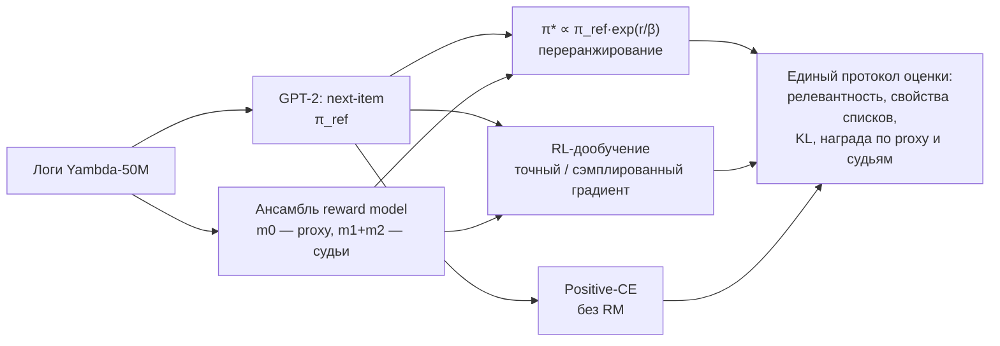
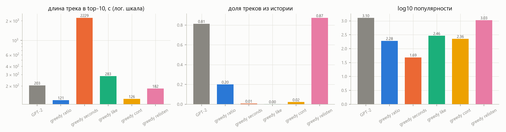

# RL-дообучение последовательной рекомендательной модели

Я обучил GPT-2 рекомендовать следующий трек на [Yambda-50M](https://huggingface.co/datasets/yandex/yambda) (Яндекс Музыка), построил ансамбль reward model, предсказывающих отклик пользователя, и проверил, что происходит при оптимизации этой награды с KL-штрафом, как в RLHF. Подробные отчёты по этапам — в [`reports/`](reports), здесь собраны постановка, главные результаты и выводы.

## Коротко

- **Награду удаётся поднять, но выигрывается она тем, что видно уже в данных.**
  - Доля дослушивания → короткие треки (203 → 122 с).
  - Лайк → длинные.
  - Секунды прослушивания → часовые записи.
  - Возврат к треку → повторы (до 95 % выдачи).
  - При сильной оптимизации выдача уходит в длинный хвост и становится одинаковой: у 25–50 % пользователей первым стоит один и тот же трек, против 0.6 % у базовой модели.
- **Слабая оптимизация может улучшать релевантность.** Переранжирование по доле дослушивания даёт NDCG@10 +6 % (95 % ДИ +4…+8 %), по вероятности возврата к треку — +13 % (+10…+16 %). Но выигрыш приходится на повторы: на новых треках эффект нулевой или отрицательный.
- **Награда с высокой неопределённостью взламывается.** Для лайка независимые reward model подтверждают лишь половину прироста, который видит оптимизируемая; для доли дослушивания — 80–85 %.
- **Обученная RL-политика проигрывает переранжированию в закрытой форме π\*.** Политика видит только идентификаторы треков, а reward model — ещё и отклик пользователя (скипы, лайки). Поэтому RL выучивает лишь усреднённую часть награды, и выдача у него однообразнее. Сэмплированный градиент, как в RLHF для языковых моделей, хуже точного и смещает выдачу к популярному.
- **Простейший бейзлайн без RL лучший по релевантности.** Дообучение только на дослушанных треках (Positive-CE) — единственный вариант, который значимо улучшает и все, и новые треки, при KL 0.06.
- **Генерация на несколько шагов ломает и рекомендации, и оценку награды.** Модель принимает собственную рекомендацию за прослушивание и начинает её повторять. Награда на шагах 2–5 определяется тем, какой отклик мы приписали сгенерированным трекам (0.61 / 0.72 / 0.89 на одной траектории), а ансамбль reward model этот артефакт не замечает.

## Данные и протокол

- **Данные.** Yambda-50M: 10 000 пользователей, 46.5 млн прослушиваний 877 тысяч треков за 301 день; лайки, дизлайки, доля дослушивания, длина трека, флаг «рекомендация или органика».
- **Разбиение** — глобальное по времени, ровно по границам из кода бенчмарка Yambda: тест — последние 24 часа, валидация — сутки до них, между ними зазоры по 30 минут. Все модели учатся только на `train`, состояние пользователя замораживается на начале тестового окна.
- **Словарь** — 172 375 треков, у которых в `train` не меньше 20 прослушиваний. Остальные треки заменяются OOV-токеном.
- **Оценка.** Для 4 600 тестовых пользователей ранжируется весь словарь; top-K сравнивается с треками, дослушанными за тестовые сутки хотя бы наполовину (Listen+). Два протокола:
  - `all` — все треки;
  - `new` — свои треки пользователя исключены из выдачи, таргеты — только новые для него.

  Метрики: NDCG, Recall, MAP, HitRate; свойства списков — покрытие каталога, Gini, сходство выдач между пользователями, длина, популярность, доля повторов, разнообразие артистов. Таргеты вне словаря остаются в знаменателях.

Подробно — в [`reports/eda.md`](reports/eda.md) и [`reports/stage1.md`](reports/stage1.md).

Главное наблюдение разведочного анализа: **70 % тестовых таргетов — повторы**, а отклик систематически зависит от длины трека. Направление каждого хака видно ещё до обучения:


## Подход



1. **Базовая модель** ([этап 1](reports/stage1.md)).
   - `GPT2LMHeadModel`: 4 слоя, `d = 256`, контекст 512, 47 млн параметров.
   - Токены — идентификаторы треков; полный softmax по 172 тысячам треков.
   - Чтобы полный softmax поместился в 8 ГБ, написана слитая функция «линейный слой + cross-entropy»: она считает градиенты по кускам, не строя матрицу логитов (в 1.6 раза быстрее варианта с checkpoint).
   - 4 эпохи, ~2.5 часа на RTX 3070 Laptop.
   - Бейзлайны: MostPop и персональные повторы с затуханием.
2. **Reward model** ([этап 2](reports/stage2.md)).
   - Каузальный трансформер по истории, где у каждого прошлого трека есть отклик: корзина доли дослушивания, лайк или дизлайк, органика, пауза.
   - Шесть выходов: доля дослушивания, Listen+, лайк, дизлайк, продолжение сессии, возврат к треку за 7 дней.
   - Голова факторизована, поэтому одно состояние оценивается против всего словаря за несколько матричных умножений.
   - Инициализация от GPT-2. Три члена ансамбля учатся на разных 80 % пользователей; 10 % пользователей не видит ни один.
   - m0 — proxy для оптимизации, m1 и m2 — независимые судьи.
3. **RL** ([этап 3](reports/stage3.md)). Одношаговый бандит с целью `E_π[r] − β·KL(π ‖ π_ref)`. Пространство действий — конечный словарь, и reward model оценивает его целиком, поэтому:
   - **π\*** — точный оптимум, переранжирование `log π_ref + r/β`; прогнан по 7 наградам × 8 значениям β и двум защитам, пессимизму по ансамблю и кандидатам top-200 базовой модели;
   - **RL с точным градиентом** — цель и её градиент считаются по всему словарю, без сэмплирования;
   - **RL с сэмплированием** — REINFORCE с групповым baseline, как в RLOO/GRPO;
   - **Positive-CE** — дообучение только на дослушанных треках, без reward model.

   Награды нормированы на свой разброс при π_ref, так что β сопоставим между ними.
4. **Многошаговая генерация** ([этап 4](reports/stage4.md)). Пять шагов, каждый сгенерированный трек добавляется в контекст. Сравнивается с той же политикой на реальном продолжении истории при трёх допущениях об отклике на сгенерированные треки.

## Результаты

### Базовая модель и reward model

| модель (test) | NDCG@10 | Recall@100 | new NDCG@10 | new Recall@100 |
|---|---|---|---|---|
| MostPop (последний день) | 0.025 | 0.056 | 0.022 | 0.056 |
| Персональные повторы | **0.203** | **0.312** | 0.022 | 0.056 |
| GPT-2 | 0.112 | 0.195 | **0.039** | **0.129** |

Повторы — очень сильный бейзлайн на всех треках, GPT-2 — единственная модель, которая работает на новых. Для сверки с бенчмарком Yambda: Recall@100 по их определению у нашей GPT-2 0.193 против 0.103 у SASRec из статьи.

| reward model (test, 209 923 события) | MAE доли | ROC-AUC Listen+ | PR-AUC лайка | PR-AUC дизлайка |
|---|---|---|---|---|
| среднее по пользователю | 0.337 | 0.728 | 0.014 | 0.036 |
| градиентный бустинг на агрегатах | 0.235 | 0.868 | 0.025 | 0.012 |
| RM m0 | **0.209** | 0.892 | 0.085 | 0.178 |
| ансамбль m0–m2 | 0.209 | **0.895** | **0.087** | **0.193** |

Reward model откалибрована (ECE ≤ 0.014) и сильнее всего выигрывает на редких событиях и на контекстных ситуациях — органике и повторах. Исключение — возврат к треку за 7 дней: здесь бустинг лучше (AUC 0.818 против 0.804), потому что видит счётчик прослушиваний трека за всю историю.

Жадный выбор по reward model (предел RL при β → 0) уже показывает все хаки ([этап 2](reports/stage2.md)):



### Оптимизация награды


Сплошная линия — награда по судьям, пунктир — по proxy, звёзды — обученные политики.

Тестовые пользователи, 4 600. Δ — разница с GPT-2 и 95 % доверительный интервал парного бутстрепа (2 000 выборок).

| политика | KL | NDCG@10 | Recall@100 | new NDCG@10 | прирост своей награды (судьи) | длина, с | из истории | топ-1 у одного трека |
|---|---|---|---|---|---|---|---|---|
| GPT-2 (π_ref) | 0 | 0.112 | 0.195 | 0.039 | — | 203 | 0.81 | 0.6 % |
| π\* доля дослуш., β = 1 | 0.60 | 0.119 (+0.007 [0.004; 0.009]) | 0.207 (+0.012 [0.009; 0.015]) | 0.037 (−0.002 [−0.004; −0.000]) | +0.069 | 185 | 0.85 | 1.1 % |
| π\* доля дослуш., β = 0.3 | 3.20 | 0.093 | 0.165 | 0.024 | +0.142 | 161 | 0.74 | 2.2 % |
| π\* возврат к треку, β = 1 | 0.94 | **0.127** (+0.015 [0.012; 0.018]) | **0.229** (+0.033 [0.030; 0.037]) | 0.039 (0.000 [−0.002; 0.002]) | +0.110 | 196 | 0.95 | 2.6 % |
| π\* лайк, β = 1 | 2.13 | 0.063 (−0.050 [−0.053; −0.046]) | 0.125 (−0.070 [−0.075; −0.066]) | 0.032 (−0.007 [−0.009; −0.005]) | +0.018 (proxy +0.033) | 217 | 0.49 | 4.8 % |
| π\* секунды, β = 3 | 6.08 | 0.056 | 0.128 | 0.008 | +876 с | 1518 | 0.30 | 21.8 % |
| RL точный, доля, β = 1 | 0.43 | 0.113 (+0.001 [−0.001; 0.004]) | 0.194 (−0.001 [−0.004; 0.002]) | 0.038 (−0.001 [−0.004; 0.001]) | +0.042 | 183 | 0.81 | 1.3 % |
| RL точный, доля, β = 0.3 | 3.13 | 0.086 | 0.151 | 0.027 | +0.109 | 144 | 0.65 | 4.6 % |
| RL сэмпл., доля, β = 0.3 | 2.05 | 0.095 | 0.171 | 0.031 | +0.071 | 171 | 0.79 | 1.6 % |
| **Positive-CE** (без RM) | **0.06** | 0.117 (+0.005 [0.003; 0.006]) | 0.197 (+0.002 [0.000; 0.004]) | **0.041** (+0.002 [0.001; 0.004]) | +0.004 | 200 | 0.82 | 0.6 % |


### Генерация на несколько шагов


## Ответы на вопросы задания

**1. Как меняется поведение модели после RL-дообучения? Удаётся ли максимизировать вознаграждение?**

- Награда растёт монотонно с KL и по proxy, и по независимым судьям: ожидаемая доля дослушивания поднимается с 0.64 до 0.84.
- Растёт она за счёт свойств треков, которые reward model связывает с наградой:
  - длина: короче для доли дослушивания и продолжения сессии, длиннее для лайков и секунд;
  - повторы для возврата к треку;
  - уход в длинный хвост каталога.
- **Почему так.**
  - Модель честно выучила закономерности данных: короткое дослушивают, длинное лайкают, знакомое переслушивают. Оптимизация доводит их до предела.
  - В награде есть слагаемые, не зависящие от пользователя (сдвиг трека и поправка на длину). При малом β они перевешивают персональную часть, поэтому выдача становится одинаковой для всех.
  - Для редких событий (лайк) около половины прироста — ошибки proxy в длинном хвосте: там ансамбль расходится в 8 раз сильнее.

**2. Сохраняется ли релевантность? Не рекомендует ли модель всем одно и то же?**

- При KL ≲ 1 и наградах, сонаправленных с поведением (доля дослушивания, возврат к треку), релевантность значимо растёт по NDCG, Recall и MAP. Новые треки при этом не выигрывают.
- Дальше релевантность быстро падает. Награды `like`, `cont`, `seconds`, `discovery` ухудшают её сразу.
- Однообразие проверено тремя способами — покрытием каталога, сходством выдач между пользователями и долей одинакового первого трека. При β ≤ 0.1 у четверти пользователей одинаковый первый трек, при награде за секунды — у половины.
- RL-политика однообразнее, чем π\* при том же KL: при β = 0.3 покрытие top-10 у неё 5.4 % против 8.1 %.

**3. Можно ли приблизиться к долгосрочным целям?**

- **Проверенные сигналы:**
  - продолжение сессии (сколько ещё треков пользователь дослушает) — механически перепутано с долей дослушивания: сессия обрывается на недослушанном треке, и оптимизация снова даёт короткие треки;
  - возврат к треку за 7 дней — reward model предсказывает его хуже бустинга, а оптимизация превращает его в «повторяй знакомое»;
  - «открытие» (новый трек, к которому вернутся) — убирает повторы, но ухудшает угадывание новых треков.
- **Слабые сигналы:**
  - время до следующей сессии: 85 % пользователей возвращаются в течение суток;
  - органические действия после рекомендации — например, пользователь потом сам ищет артиста.
- **Что можно проверить офлайн:**
  - качество предсказания долгосрочного сигнала на отложенных пользователях;
  - согласие независимых reward model;
  - сдвиг распределения выдачи;
  - совпадение с реальным поведением на следующий день.
- **Что нельзя:** причинный эффект рекомендаций на возвраты. Логи собраны прошлой системой, вероятности показа неизвестны, а петли обратной связи и привыкание проявляются за недели. Нужен A/B-тест с метриками удержания. До него — off-policy оценка с восстановленной политикой логирования, как в статье 2607.02818.

**4. Что происходит при генерации нескольких шагов вперёд?**

- **Модель принимает свою рекомендацию за прослушивание.**
  - В 71–78 % шагов (у RL-политики в 95–99 %) самый вероятный следующий трек — только что сгенерированный.
  - Растут цепочки одного артиста.
  - Реальных попаданий становится меньше: 15 % → 9.5 %.
- **Рекомендации расходятся с реальностью.** К 5-му шагу NDCG@10 на треть ниже, чем при реальном продолжении истории; с реальным продолжением он, наоборот, растёт.
- **Оценка награды становится артефактом.** Она определяется приписанным откликом: оптимистичное допущение («дослушал») превращает любую траекторию в выигрышную. Судьи согласны с proxy при любом допущении, а при оптимистичном ансамбль становится даже увереннее.
- **Next-K-слейт** (как в GPTRec) по NDCG@5 не хуже top-K, но угадывает меньше пользователей и менее разнообразен.
- **Многошаговый RL я не обучал.** Его цель можно поднять выбором допущения об отклике. Для честной многошаговой оптимизации нужен симулятор, который сэмплирует отклик и проверен на реальных траекториях.

**5. Каков компромисс между релевантностью и вознаграждением?**

- Увеличить награду без потери точности можно, но немного (KL ≲ 1) и только для наград, сонаправленных с тем, что пользователь реально делает.
- Компромисс определяется:
  - **в первую очередь функцией вознаграждения:** доля дослушивания и возврат к треку дают выигрыш при малом β, лайк и секунды — потери сразу;
  - **во вторую — силой KL;**
  - **в третью — методом:** обученная политика лежит внутри фронта π\*, сэмплирование хуже точного градиента.
- Пессимизм по ансамблю (κ = 1) немного сдвигает фронт для лайка; ограничение кандидатами базовой модели срезает достижимый прирост.

## Выводы

1. **Конечное пространство действий даёт преимущество, которого нет у языковых моделей.** Оптимальную KL-регуляризованную политику можно посчитать точно, и это сильный и дешёвый бейзлайн для любого RL в рекомендациях. Обученная политика проигрывает ему, если видит меньше информации, чем reward model.
2. **Reward hacking в рекомендациях бывает двух видов.**
   - Честная оптимизация неудачной цели: короткие треки ради доли дослушивания, повторы ради возвратов. Ансамбль его не замечает, потому что закономерность есть в данных.
   - Эксплуатация ошибок модели в длинном хвосте, как с лайками. Его видно по разрыву proxy и судей и по разбросу ансамбля.
3. **Что выигрывает в релевантности.** Улучшение релевантности на тесте в основном означает «больше повторов» (70 % таргетов — повторы). Единственный вариант, значимо улучшающий новые треки, — Positive-CE без reward model.
4. **Многошаговые оценки по reward model офлайн ненадёжны.** Решения о долгосрочных целях нельзя принимать без онлайн-проверки.

## Ограничения и что можно сделать дальше

- **Ограничения:**
  - один датасет и один сид на каждую конфигурацию RL;
  - доверительные интервалы посчитаны только для ключевых сравнений (`reports/results/bootstrap_ci.json`);
  - proxy и судьи — одна архитектура на одних логах, поэтому их согласие не равно истине;
  - отклик на треки, которых пользователь не слушал, офлайн не проверить.
- **Что можно сделать дальше:**
  - политика с признаками отклика (сократит разрыв RL и π\*);
  - счётчик прослушиваний трека в reward model (для возврата к треку);
  - многошаговая оптимизация с симулятором, который сэмплирует отклик, и off-policy коррекцией;
  - награды-комбинации с явным бонусом за новизну и ограничением на длину;
  - проверка на Yambda-500M и KION.

## Отчёты по этапам

| этап | содержание |
|---|---|
| [0. Данные и EDA](reports/eda.md) | разбиение, отклик, повторы, сессии, лайки, словарь |
| [1. Базовая модель](reports/stage1.md) | GPT-2, протокол оценки, бейзлайны, сверка с бенчмарком |
| [2. Reward model](reports/stage2.md) | метки, архитектура, ансамбль, качество, жадные списки |
| [3. RL-дообучение](reports/stage3.md) | π\*, RL, защиты, переоптимизация, ответы на вопросы 1, 2, 3, 5 |
| [4. Многошаговая генерация](reports/stage4.md) | дрейф контекста, оценка награды, Next-K против Top-K |

## Воспроизведение

Нужны Python 3.12 и GPU с CUDA 12.x (все эксперименты выполнены на RTX 3070 Laptop 8 ГБ и 16 ГБ RAM). Обучение на ноутбуке стоит запускать от сети: от батареи GPU ограничен ~30 Вт и работает в 7 раз медленнее.

```bash
py -3.12 -m venv .venv
.venv/Scripts/python -m pip install -r requirements.txt
.venv/Scripts/python -m pip install -e .
```

Данные (~400 МБ) скачиваются в `data/raw/`, EDA занимает ~2 мин:

```bash
.venv/Scripts/python scripts/download_data.py
.venv/Scripts/python scripts/eda.py
```

Этап 1: словарь (~1 мин), бейзлайны (~4 мин), GPT-2 (~2.5 ч), оценка. Прерванное обучение продолжается с `--resume checkpoints/base/last.pt`.

```bash
.venv/Scripts/python scripts/prepare_data.py
.venv/Scripts/python scripts/baselines.py
.venv/Scripts/python scripts/train_base.py --out checkpoints/base
.venv/Scripts/python scripts/evaluate_model.py --ckpt checkpoints/base/best.pt --name GPT2 --parts val test
.venv/Scripts/python scripts/report_stage1.py --models GPT2
```

Этап 2: метки отклика, ансамбль reward model (~35 мин; скрипт перезапускаемый), оценка с бейзлайнами (~10 мин), жадные списки (~3 мин):

```bash
.venv/Scripts/python scripts/prepare_rm_data.py
powershell -ExecutionPolicy Bypass -File scripts/train_rm_ensemble.ps1
.venv/Scripts/python scripts/evaluate_rm.py
.venv/Scripts/python scripts/rm_preferences.py
.venv/Scripts/python scripts/report_stage2.py
```

Этап 3: масштабы наград, прогон π\* (113 политик, ~15 мин), RL-прогоны и Positive-CE (~55 мин; перезапускаемый), оценка обученных политик, доверительные интервалы, графики:

```bash
.venv/Scripts/python scripts/rl_scales.py
.venv/Scripts/python scripts/rl_sweep.py
powershell -ExecutionPolicy Bypass -File scripts/rl_runs.ps1
.venv/Scripts/python scripts/rl_sweep.py --no-grid --out reports/results/rl_policies.json --policies ratio:RL-exact-b1=checkpoints/rl/ratio_b1_exact/policy.pt ratio:RL-exact-b0.3=checkpoints/rl/ratio_b0.3_exact/policy.pt ratio:RL-sampled-b0.3=checkpoints/rl/ratio_b0.3_sampled/policy.pt ratio:Positive-CE=checkpoints/rl/positive_ce/policy.pt like:RL-exact-b1=checkpoints/rl/like_b1_exact/policy.pt relisten:RL-exact-b0.3=checkpoints/rl/relisten_b0.3_exact/policy.pt
.venv/Scripts/python scripts/bootstrap_ci.py
.venv/Scripts/python scripts/report_stage3.py
```

Этап 4: пятишаговые развёртки для 2 000 пользователей (~15 мин):

```bash
.venv/Scripts/python scripts/rollouts.py
.venv/Scripts/python scripts/report_stage4.py
```

Тесты (нужен GPU):

```bash
.venv/Scripts/python -m pytest tests
```

## Структура репозитория

```
src/seqrec_rl/
  data.py                загрузка, разбиение по времени, привязка лайков, словарь
  model.py               GPT-2, слитый linear + cross-entropy, нарезка окон, рекомендатель
  evaluation.py          протокол оценки, ranking-метрики, свойства списков
  baselines.py           MostPop, персональные повторы
  reward_data.py         признаки и метки отклика
  reward.py              reward model, обучение и предсказания
  reward_eval.py         метрики качества reward model
  response_baselines.py  средние и бустинг для отклика
  rl.py                  награды, π*, точный и сэмплированный лоссы, состояния для RL
  rollout.py             многошаговая генерация с допущениями об отклике
  plotting.py            общий стиль графиков
scripts/                 шаги пайплайна (см. «Воспроизведение»)
tests/                   проверки лосса и нарезки окон
reports/                 отчёты по этапам, графики, результаты в JSON
data/, checkpoints/, runs/   данные, веса и логи (не в git)
```
