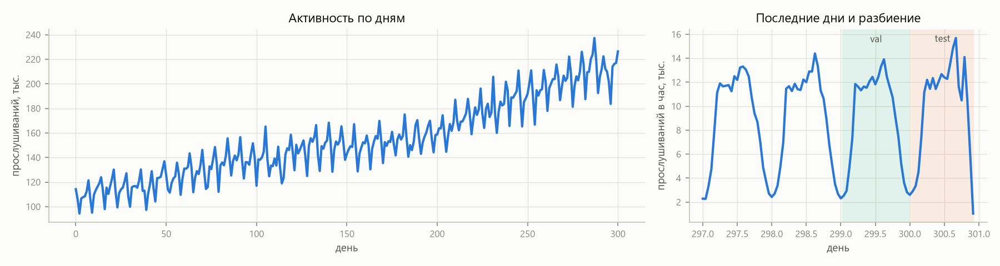
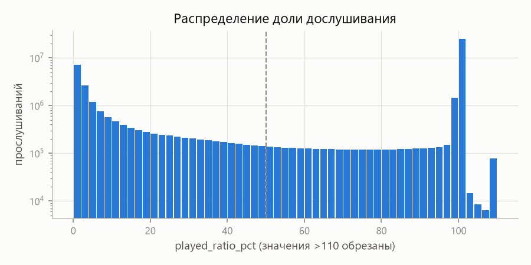
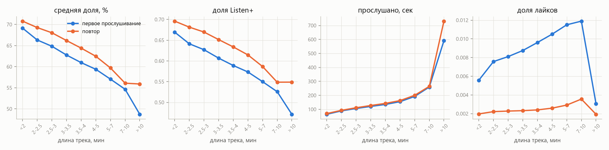
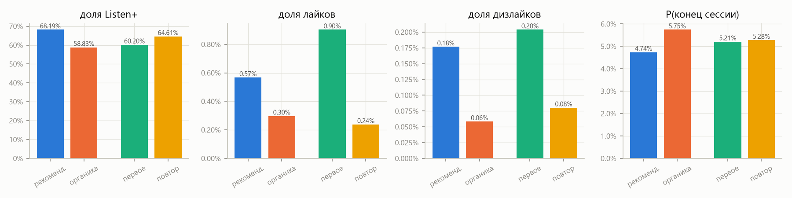
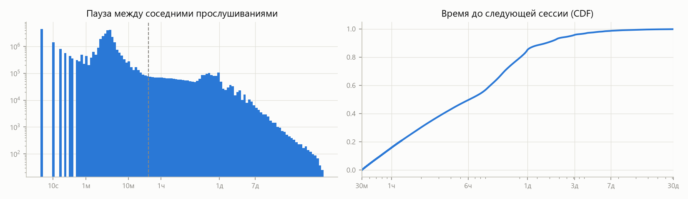
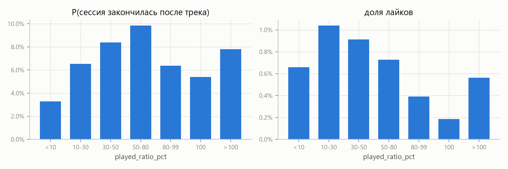
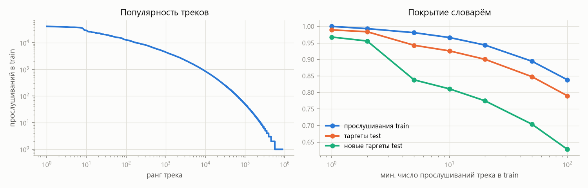

# Этап 0. Данные и разведочный анализ (Yambda-50M)

Все числа ниже считает `scripts/eda.py` и сохраняет в [`eda_stats.json`](eda_stats.json). Графики лежат в [`figures/`](figures).

## Данные

Yambda-50M, файл `flat/50m/multi_event.parquet`:

| | |
|---|---|
| пользователи | 10 000 |
| треки (все события) | 934 057 |
| треки с прослушиваниями | 877 168 |
| прослушивания | 46 467 212 |
| лайки / дизлайки | 881 456 / 107 776 |
| отмены лайков / дизлайков | 312 972 / 21 033 |
| период | 300.9 дня |

`timestamp` хранится в секундах от начала датасета и округлён до 5 с (все значения кратны 5). Длина трека у каждого трека одна и та же во всех событиях. Маппинг трек → артист покрывает 99.98 % прослушиваний: 144 486 артистов, у 0.015 % треков их несколько.

## Разбиение по времени

```
train [0, 299 д) | 30 мин | val [299 д + 30 мин, 300 д) | 30 мин | test [300 д + 30 мин, конец ≈ 300.93 д)
```

- Тест совпадает с тестом бенчмарка Yambda: начинается через 30 минут после 300-го дня и идёт до конца данных, около 22 часов. Валидация — последний день обучающего периода бенчмарка.
- Модели учатся на `train` и замораживаются. В тесте история пользователя — все события до 300-го дня, включая валидацию. События внутри зазоров не используются ни как история, ни как таргеты.
- Для RL используются только контексты из `train`.

| | val | test |
|---|---|---|
| прослушиваний | 215 884 | 225 140 |
| пользователей с прослушиваниями | 4 837 | 4 759 |
| таргеты Listen+ (≥ 50 % трека) | — | 152 899 у 4 550 пользователей (медиана 18 на пользователя) |
| лайков | — | 4 139 |

Холодных пользователей в тесте нет. **70.6 % тестовых таргетов — треки, которые пользователь уже слушал раньше.** Поэтому метрики релевантности будем считать в двух вариантах: по всем таргетам и только по новым трекам.



Активность за период выросла почти вдвое: со ~115 до ~220 тысяч прослушиваний в день. Видны недельная и суточная сезонность. Тест — неполные сутки, в основном дневные часы, а распределение пользователей и треков в нём сдвинуто относительно начала периода. Поэтому разбиение по времени, а не случайное, здесь обязательно.

## Отклик: доля дослушивания



Распределение `played_ratio_pct` двугорбое:
- **53.2 %** прослушиваний ровно 100 %;
- **26.6 %** — меньше 10 % (скипы);
- в середине распределение плоское;
- Listen+ (≥ 50 %) — 63.4 %;
- больше 100 % (перемотка назад) — 0.5 %.

Для reward model разумно предсказывать не только среднюю долю, но и вероятность скипа и полного прослушивания: среднее по такому распределению плохо его описывает.

## Отклик и длина трека → куда «потянет» RL



Это главный результат EDA для третьего этапа.

| что оптимизируем | короткие треки (< 2 мин) | длинные треки (7–10 мин) | куда потянет RL |
|---|---|---|---|
| средняя доля дослушивания | 69–71 % | 55–56 % | **к коротким** |
| доля Listen+ | 0.67–0.70 | 0.53–0.55 | **к коротким** |
| прослушано секунд | ~65 | ~260 | **к длинным** |
| доля лайков (первые прослушивания) | 0.56 % | 1.19 % | к длинным |

Корреляция Спирмена между долей и длиной на уровне отдельных прослушиваний слабая (−0.05), но средние по корзинам меняются монотонно. Значит, на уровне выбора трека эффект систематический.

Кроме того, **повторные прослушивания дослушиваются лучше первых** при любой длине: Listen+ 64.6 % против 60.2 %. Награда «доля дослушивания» поощряет и короткие треки, и уже знакомые. Это ровно те два хака, о которых говорится в задании, и в данных они видны ещё до обучения.

## Повторы

- **71.4 %** прослушиваний — повторы трека, который пользователь уже слушал в пределах датасета.
- Повторы дослушивают лучше, но лайкают в 4 раза реже: 0.24 % против 0.90 %. Трек обычно лайкают один раз, при первом знакомстве.
- Медианное расстояние до предыдущего прослушивания того же трека — **334 прослушивания**. Только 46 % повторов попадают в последние 256 событий истории (33 % всех прослушиваний), в последние 1024 — 83 %. Подряд один и тот же трек — 2.6 % прослушиваний.

Следствие для модели: при контексте 256 большая часть повторов не видна в истории. Повторы — самый простой способ «поднять» награду, и в контексте 256 модель видит меньше половины из них. Длину контекста (256 или 512) выберу на этапе 1 по качеству и скорости. Повторы будут отдельной осью анализа.

## Органика и рекомендации



| | рекомендации (`is_organic = 0`) | органика (`is_organic = 1`) |
|---|---|---|
| доля прослушиваний | 48.3 % | 51.7 % |
| Listen+ | 68.2 % | 58.8 % |
| лайки | 0.57 % | 0.30 % |
| дизлайки | 0.18 % | 0.06 % |
| новые треки среди прослушиваний | 38 % | 19 % |

Рекомендованное дослушивают и лайкают чаще органики. Похоже, органика — это в основном прослушивание своей коллекции с перескоками. Отклик зависит от контекста подачи. Поэтому reward model будет получать `is_organic` целевого события как признак, а кандидатов будем оценивать в режиме «рекомендация» (`is_organic = 0`): именно так их увидит пользователь.

Логи собраны под действием рекомендательной системы Яндекса. Почти половина прослушиваний — её выбор, и в рекомендованном 62 % — повторы. Это смещение отбора: reward model учится только на тех парах «контекст — трек», которые показала прошлая система.

## Лайки и дизлайки

- В логах лайк — отдельное событие. Я привязываю его к последнему прослушиванию того же трека, если лайк поставлен не позже чем через `длина трека + 60 с` после его начала.
- Так привязываются **22.3 % лайков**. Медианная задержка от начала прослушивания до лайка — 11 минут. У **44.5 % лайков** вообще нет предшествующего прослушивания этого трека: вероятно, их ставили из выдачи или альбома без проигрывания.
- Доля прослушиваний с лайком — **0.43 %**, с дизлайком — **0.12 %**. Дизлайки обычно ставят прямо во время трека: медианная задержка 70 с, 49 % привязываются.
- Лайк — редкий сигнал. Для ориентира: в статье 2607.02818 на Yambda-5B like PR-AUC 0.24 при базовой частоте 1.1 %. Поэтому reward на одних лайках будет шумным, нужна комбинация с долей дослушивания.

## Сессии и возвраты



Сессия — прослушивания, между которыми меньше 30 минут. Пик пауз около 3 минут — это длина трека, когда треки идут подряд.

- Сессий 2.45 млн; медиана — 10 прослушиваний, среднее — 19.
- До следующей сессии в медиане 6.2 часа. В течение 24 часов возвращаются **85 %**, в течение 7 дней — 98.7 %.

Бинарный сигнал «вернулся в течение суток» почти всегда равен единице: в датасет отбирали активных пользователей. Для долгосрочной награды информативнее непрерывные величины: время до возврата, длина остатка сессии, число Listen+ до её конца.



Есть ловушка. Сессия чаще всего заканчивается на частично прослушанном треке (50–80 %: 9.8 %), реже всего — после скипа (< 10 %: 3.3 %). Это механический эффект: пользователь закрыл приложение посреди трека, и его доля оборвалась. Сигнал «на этом треке сессия закончилась» перепутан с долей дослушивания. Если наивно наградить «продолжение сессии», это не будет независимым долгосрочным сигналом. Это надо учесть при формулировке long-term reward на этапе 3.

## Популярность и словарь



| мин. прослушиваний в train | треков | покрытие прослушиваний train | покрытие таргетов test | покрытие новых таргетов test |
|---|---|---|---|---|
| 1 | 872 953 | 100 % | 98.9 % | 96.8 % |
| 5 | 351 388 | 98.1 % | 94.3 % | 83.8 % |
| 10 | 248 986 | 96.6 % | 92.6 % | 81.1 % |
| 20 | 172 415 | 94.3 % | 90.0 % | 77.5 % |
| 50 | 100 425 | 89.5 % | 84.8 % | 70.4 % |
| 100 | 63 662 | 83.8 % | 79.0 % | 62.8 % |

Полный словарь из 873 тысяч треков с softmax на 8 ГБ GPU не помещается. Варианты — порог 20 (172 тысячи токенов) или 50 (100 тысяч). Порог 50 теряет 30 % новых таргетов, но для RL-экспериментов удобнее: награду считаем точным ожиданием по всему словарю на каждом шаге. Таргеты вне словаря в метриках остаются промахами для всех моделей, так что сравнение честное. Окончательный порог выберу на этапе 1 по памяти и скорости. Редкие треки в истории заменяются одним OOV-токеном, чтобы не ломать временную структуру.

## Что это значит для следующих этапов

1. **Протокол:** разбиение по времени из таблицы выше. Таргеты — Listen+ и лайки; метрики — по всем и по новым трекам.
2. **Базовая модель:** контекст 256–512. Сильный бейзлайн — персональные повторы: 70 % таргетов уже есть в истории.
3. **Reward model** учитывает:
   - что доля дослушивания распределена двугорбо;
   - зависимость отклика от длины трека, повтора и `is_organic`;
   - что лайк — редкое событие.

   Длину трека и признак «трек уже есть в истории» подаём явно, чтобы потом проверять, что именно эксплуатирует RL.
4. **Ожидаемые хаки на этапе 3:**
   - награда за долю дослушивания → короткие треки и повторы;
   - награда за секунды → длинные треки;
   - награда за лайки → новые и длинные треки.

   Это проверяемые гипотезы: после RL сравним длину, долю повторов и популярность рекомендаций с базовой моделью.
5. **Долгосрочная награда:** «вернулся за 24 часа» почти константа, а «конец сессии» перепутан с долей дослушивания. Кандидаты — число Listen+ до конца сессии с дисконтом, время до следующей сессии и «прижившиеся открытия» (новый артист, к которому пользователь потом возвращается сам).
