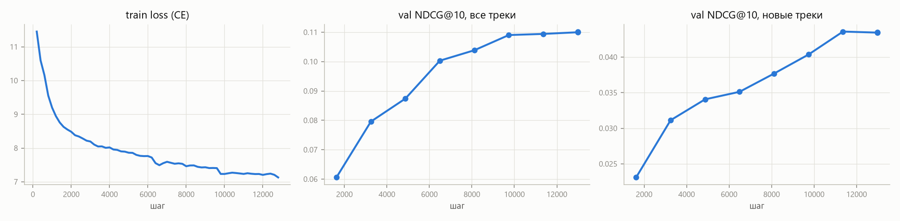

# Этап 1. Базовая GPT-2 модель и бейзлайны

## Постановка

**Словарь.**
- Токены получают треки, у которых в `train` не меньше 20 прослушиваний: это 172 375 треков.
- Ещё два служебных токена — `PAD` и `OOV`. Под `OOV` попадают редкие треки в истории (5.7 % прослушиваний `train`), чтобы не ломать временную структуру последовательности. `OOV`-таргеты в лоссе пропускаются.
- Токены упорядочены по популярности в `train`.
- Скрипт — [`scripts/prepare_data.py`](../scripts/prepare_data.py).

**Модель** — `GPT2LMHeadModel` из `transformers`: 4 слоя, `d_model = 256`, 4 головы, контекст 512, dropout 0.1. Эмбеддинги входа и выхода общие, как в GPT-2. Всего 47.4 млн параметров, из них 44 млн — эмбеддинги треков. Токены — идентификаторы треков в хронологическом порядке, без признаков отклика. Это чистая задача next item prediction: модель предсказывает, что пользователь включит следующим, включая треки, которые он потом пропустит.

**Лосс — полный softmax по всему словарю.** Сэмплированный softmax быстрее, но даёт смещённые вероятности. На этапе 3 эта модель станет референсной политикой, KL к ней и сэмплирование из неё должны быть честными.

Матрица логитов `B × L × V` для батча 32 × 512 × 172 тысячи в 8 ГБ не помещается. Поэтому написана слитая функция «линейный слой + cross-entropy» ([`model.py`](../src/seqrec_rl/model.py), `LinearCrossEntropy`). Она идёт по кускам из 2048 позиций, сразу считает градиенты (softmax − one-hot) и ничего не пересчитывает в backward. Это в 1.6 раза быстрее варианта с `checkpoint`. Корректность проверена тестом против `F.cross_entropy` ([`tests/test_model.py`](../tests/test_model.py)).

**Обучение** ([`scripts/train_base.py`](../scripts/train_base.py)):

| параметр | значение |
|---|---|
| оптимизатор | AdamW, lr 1e-3, β = (0.9, 0.98), weight decay 0.01 |
| расписание lr | warmup 1000 шагов, cosine до 0.1·lr |
| батч | 32 окна по 512 токенов |
| точность | bf16 |
| длительность | 4 эпохи = 12 988 шагов, ~2.5 часа на RTX 3070 Laptop |

- Окна нарезаются из последовательности каждого пользователя со случайной фазой. За эпоху каждая позиция служит таргетом ровно один раз.
- Лучший чекпойнт выбирался по NDCG@10 на валидации.
- Обучение один раз прервалось. Оно продолжено с чекпойнта шага 6492 со свежими моментами Adam и коротким повторным warmup на 200 шагов. Отсюда небольшой бугор на кривой лосса после 6500 шагов.

На валидации качество растёт до конца и к 4-й эпохе выходит на плато: NDCG@10 0.110 по всем трекам, 0.043 по новым.

## Протокол оценки

Протокол один для всех моделей этого и следующих этапов ([`evaluation.py`](../src/seqrec_rl/evaluation.py)).

- Состояние пользователя замораживается на начале тестового окна (последние 24 часа данных).
- Один раз ранжируется весь словарь, top-100 сравнивается с треками, которые пользователь дослушал в окне хотя бы наполовину (Listen+, уникальные). Таких пользователей 4 600.
- **Протокол `all`** — ничего не фильтруется. Дополнительно считаются таргеты-лайки: 1 112 пользователей.
- **Протокол `new`** — треки из истории пользователя убираются из выдачи, таргеты — только треки, которые он раньше не слушал. Таких пользователей 3 309.
- Таргеты вне словаря остаются в знаменателях. Для всех моделей это одинаковый штраф: потолок 90 % на всех таргетах и 78 % на новых.

Метрики:
- Recall@K = попадания / min(|T|, K);
- NDCG@K с бинарной релевантностью;
- MAP@K с нормировкой на min(|T|, K);
- HitRate@K.

Свойства списков:
- coverage — доля словаря, попавшая хоть в один top-K;
- Gini показов;
- средний Jaccard top-10 между случайными парами пользователей;
- доля треков из истории пользователя;
- популярность (log10 числа прослушиваний в train);
- длина трека;
- число разных артистов в top-10.

### Сравнение с бенчмарком Yambda

Recall в коде бенчмарка совпадает с нашим. Но в комментарии к нему сказано, что числа в статье посчитаны с делением на |T|. Поэтому для сверки дополнительно считается `recall_raw = попадания / |T|`.

NDCG из кода бенчмарка с нашим не сравнить. Там идеальный DCG считается по маске попаданий, а не по таргетам (`ideal_dcg = calc_dcg(target_mask)`), и метрика фактически превращается в hit rate.

| Yambda-50M, test | Listen+ Recall@10 | Listen+ Recall@100 | Like Recall@10 | Like Recall@100 |
|---|---|---|---|---|
| SASRec из статьи Yambda | 0.0325 | 0.1026 | 0.0175 | 0.0603 |
| наш GPT-2 (`recall_raw`) | 0.0638 | 0.1928 | 0.0206 | 0.1002 |

Порядок величин совпадает. Наша модель примерно вдвое лучше SASRec из статьи, у которого авторы не подбирали гиперпараметры. Протоколы различаются в деталях: у нас валидационный день не входит в обучение, есть OOV, таргеты дедуплицированы. Так что это проверка адекватности, а не строгое сравнение.

## Бейзлайны

Подобраны на валидации по NDCG@10 ([`scripts/baselines.py`](../scripts/baselines.py), сетка — [`results/baselines_val_grid.json`](results/baselines_val_grid.json)).

- **MostPop** — самые прослушиваемые треки за последние N дней до среза. Лучший вариант — N = 1 день: в музыке популярность быстро меняется.
- **PersonalRepeat** — свои треки пользователя, отсортированные по числу прослушиваний с экспоненциальным затуханием γ на каждое прослушивание. Лучшая настройка: γ = 0.998 (горизонт ~500 прослушиваний), учитываются только дослушанные (Listen+). Остаток списка добивается MostPop. В протоколе `new` все свои треки отфильтрованы, и бейзлайн совпадает с MostPop.

## Результаты на тесте

Релевантность:

| модель | NDCG@10 | Recall@10 | MAP@10 | HitRate@10 | NDCG@100 | Recall@100 | new NDCG@10 | new Recall@100 | like NDCG@100 | like Recall@100 |
|---|---|---|---|---|---|---|---|---|---|---|
| MostPop | 0.025 | 0.026 | 0.011 | 0.149 | 0.034 | 0.056 | 0.022 | 0.056 | 0.028 | 0.072 |
| PersonalRepeat | **0.203** | **0.203** | **0.145** | **0.460** | **0.233** | **0.312** | 0.022 | 0.056 | 0.031 | **0.107** |
| GPT-2 | 0.112 | 0.110 | 0.065 | 0.400 | 0.139 | 0.195 | **0.039** | **0.129** | **0.032** | 0.100 |

Свойства top-10, протокол `all`:

| модель | coverage@10 | coverage@100 | Gini | Jaccard пар | из истории | log10 попул. | длина, с | артистов |
|---|---|---|---|---|---|---|---|---|
| MostPop | 0.00006 | 0.0006 | 1.000 | 1.000 | 0.21 | 3.41 | 165 | 9.0 |
| PersonalRepeat | 0.135 | 0.534 | 0.922 | 0.001 | 1.00 | 3.01 | 200 | 8.4 |
| GPT-2 | 0.109 | 0.372 | 0.944 | 0.001 | 0.81 | 3.10 | 203 | 7.5 |

Все таблицы целиком — [`results/stage1_tables.md`](results/stage1_tables.md). Сырые результаты — `results/*_test.json`.

## Выводы

1. **На всех треках повторы сильнее next-item модели: NDCG@10 0.203 против 0.112.**
   - 70 % тестовых таргетов — треки, которые пользователь уже слушал. Список «своё любимое за последнее время» почти в половине случаев угадывает хотя бы один трек из топ-10.
   - GPT-2 тоже научилась повторам: 81 % её top-10 — треки из истории. Но у неё два ограничения. Она видит только последние 512 прослушиваний, а бейзлайн — всю историю. И она обучена предсказывать следующее включение, включая скипы, а оцениваем мы дослушанное за сутки.
   - Бейзлайн с фильтром Listen+ лучше, чем без него (0.207 против 0.199 на валидации). Значит, сам отклик несёт сигнал о том, что пользователь захочет снова. Это довод в пользу RL с наградой по отклику.
2. **На новых треках GPT-2 — единственная модель, которая работает лучше популярного.** NDCG@10 у неё 0.039 против 0.022, Recall@100 — 0.129 против 0.056. При K = 100 GPT-2 обгоняет повторы и по HitRate на всех треках: 0.740 против 0.709.
3. **Лайки предсказываются плохо у всех.** Recall@100 около 0.10: лайкают в основном новое, а новое угадывать трудно.
4. **Поведение базовой модели — точка отсчёта для этапа 3:**
   - выдача персональная: Jaccard между пользователями 0.001, Gini 0.94;
   - охват — 37 % словаря в top-100;
   - средняя длина рекомендованного трека — 203 с, как в среднем по прослушиваниям (207 с), то есть смещения к коротким трекам пока нет;
   - популярность выше средней по словарю, но ниже MostPop;
   - в top-10 в среднем 7.5 разных артистов — модель часто даёт несколько треков одного исполнителя.

   После RL будем смотреть, как сдвигаются именно эти величины: длина, доля повторов, популярность, разнообразие.

## Ограничения

- **Одна обученная модель, один сид, подбора гиперпараметров не было.** Валидация использовалась только для выбора чекпойнта. Доверительных интервалов пока нет. Бутстреп по пользователям добавлю, когда будет что сравнивать с RL.
- **Длина контекста.** Контекст 512 закрывает примерно половину повторов (см. EDA). Модель с доступом ко всей истории или гибрид с PersonalRepeat был бы сильнее на протоколе `all`. Это не цель задания, поэтому базой остаётся чистая GPT-2.
- **OOV.** 10 % тестовых таргетов (22 % новых) вне словаря и недостижимы для всех моделей.
