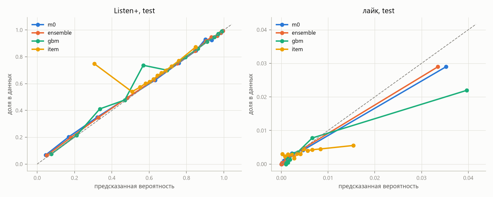

# Этап 2. Reward model

## Что предсказываем

Reward model оценивает отклик пользователя на трек с учётом всей его истории. Метки считаются по каждому прослушиванию ([`reward_data.py`](../src/seqrec_rl/reward_data.py)):

| выход | что это | доля / среднее |
|---|---|---|
| `ratio` | доля дослушивания, обрезанная до [0, 1] | 0.65 |
| `listen_plus` | дослушан хотя бы наполовину | 0.63 |
| `like` / `dislike` | лайк или дизлайк в пределах «длина трека + 60 с» от начала прослушивания | 0.43 % / 0.12 % |
| `cont` | продолжение сессии: Σ 0.9^(j−1) · [Listen+ на j-м следующем треке той же сессии], j ≤ 20, нормировано на максимум | 0.45 |
| `relisten` | возврат к треку: пользователь снова дослушал его через 1 ч – 7 дней | 0.28 |

`cont` и `relisten` — кандидаты в долгосрочную награду для этапа 3. Первый отвечает на вопрос, держит ли трек пользователя в сессии. Второй — стал ли трек тем, к чему пользователь возвращается.

У `relisten` метка видна только через 7 дней после события. Поэтому в обучении она маскируется для последней недели `train` и на тестовых и валидационных сутках не оценивается.

## Модель

[`reward.py`](../src/seqrec_rl/reward.py) — каузальный трансформер той же формы, что базовая GPT-2: 4 слоя, `d = 256`, контекст 512.

На каждой позиции истории складываются эмбеддинги:
- трека;
- корзины доли дослушивания (7 корзин);
- флагов: лайк, дизлайк, органика;
- корзины паузы от предыдущего события.

Голова факторизована:

```
logit_k(s, a) = ⟨u_k(s), e_a⟩ + c_k(s) + b_k(a) + len_k(длина a) + [органика] · o_k(s)
```

У `u` и `c` две версии — для треков, которые пользователь уже слушал, и для новых. Благодаря этому одно состояние сравнивается со всем словарём из 172 тысяч треков за несколько матричных умножений. На этапе 3 это даст точное ожидание награды по всей политике.

Признак «органика» у кандидата при оценке рекомендаций выключен: трек показывается как рекомендация.

Чтобы reward model работала на сгенерированных треках, у которых отклика нет (этап 4), на 5 % позиций обучения отклик и паузы заменяются токеном «неизвестно».

**Обучение** ([`scripts/train_rm.py`](../scripts/train_rm.py)):
- лосс — BCE по всем шести выходам, для `ratio` и `cont` с мягкими метками, то есть модель предсказывает среднее;
- AdamW, lr 5e-4, 2 эпохи; на валидации к концу второй эпохи кривая выходит на плато;
- одна модель обучается около 8 минут на RTX 3070 Laptop от сети;
- трансформер и эмбеддинги треков взяты из базовой GPT-2.

**Ансамбль** ([`scripts/train_rm_ensemble.ps1`](../scripts/train_rm_ensemble.ps1)):
- 10 % пользователей (1 000) не видит ни одна reward model;
- каждый член учится на своих случайных 80 % от остальных;
- **m0 — proxy**, награда для RL;
- **m1 и m2 — судьи**, только для оценки;
- **scratch10** — та же архитектура без инициализации от GPT-2, для абляции.

## Протокол оценки

[`scripts/evaluate_rm.py`](../scripts/evaluate_rm.py). Каждое событие предсказывается по всему, что было до него (teacher forcing). Оцениваются только треки из словаря.

| набор | что | событий | пользователей |
|---|---|---|---|
| test | последние 24 часа, все пользователи | 209 923 | 4 812 |
| val | валидационные сутки | 199 390 | 4 849 |
| holdout | пользователи, которых не видела ни одна RM, события за [T − 14 д, T − 7 д), T = конец `train` | 137 461 | 804 |

Только на `holdout` метка `relisten` полностью наблюдается.

**Бейзлайны** ([`response_baselines.py`](../src/seqrec_rl/response_baselines.py)):
- глобальное среднее;
- сглаженные средние по треку и по пользователю, посчитанные по данным до среза;
- **градиентный бустинг** (`HistGradientBoosting`, свой для каждого выхода).

Признаки бустинга:
- средние по треку и по пользователю;
- повтор или нет;
- сколько раз пользователь слушал этот трек;
- время с прошлого прослушивания трека;
- доля дослушивания предыдущего трека;
- доля Listen+ за последние 20 событий;
- органика;
- длина трека.

Бустинг обучен на 2 млн событий последних 14 дней `train` (без holdout-пользователей). Агрегаты для него посчитаны по данным до этих 14 дней, так что утечки таргета нет.

## Результаты

Test (полные таблицы для всех наборов — [`results/stage2_tables.md`](results/stage2_tables.md)):

| модель | ratio MAE | ratio Spearman | Listen+ ROC-AUC | Listen+ ECE | like ROC-AUC | like PR-AUC | dislike PR-AUC | cont MAE | cont Spearman |
|---|---|---|---|---|---|---|---|---|---|
| глобальное среднее | 0.407 | — | 0.500 | 0.043 | 0.500 | 0.003 | 0.001 | 0.321 | — |
| среднее по треку | 0.404 | 0.121 | 0.582 | 0.052 | 0.572 | 0.005 | 0.001 | 0.321 | 0.088 |
| среднее по пользователю | 0.337 | 0.381 | 0.728 | 0.055 | 0.746 | 0.014 | 0.036 | 0.270 | 0.401 |
| бустинг | 0.235 | 0.621 | 0.868 | 0.024 | 0.854 | 0.025 | 0.012 | 0.233 | 0.606 |
| RM с нуля | 0.217 | 0.653 | 0.889 | 0.010 | 0.893 | 0.081 | 0.172 | 0.224 | 0.643 |
| **RM m0 (proxy)** | **0.209** | 0.658 | 0.892 | 0.014 | 0.906 | 0.085 | 0.178 | 0.213 | 0.676 |
| ансамбль m0–m2 | 0.209 | **0.663** | **0.895** | **0.009** | **0.908** | **0.087** | **0.193** | **0.211** | **0.681** |

`relisten` на holdout-пользователях:

| модель | ROC-AUC | PR-AUC (база 0.28) |
|---|---|---|
| среднее по пользователю | 0.702 | 0.478 |
| бустинг | **0.818** | **0.663** |
| RM с нуля | 0.771 | 0.578 |
| RM m0 | 0.804 | 0.655 |
| ансамбль m0–m2 | 0.807 | 0.657 |

ROC-AUC Listen+ по срезам test:

| срез | бустинг | RM m0 |
|---|---|---|
| органика | 0.823 | **0.871** |
| рекомендации | 0.905 | **0.911** |
| повторы | 0.853 | **0.884** |
| новые треки | 0.903 | **0.912** |

PR-AUC лайка по тем же срезам: 0.017 → 0.112, 0.032 → 0.072, 0.018 → 0.066, 0.031 → 0.102.



### Выводы по качеству

1. **Reward model заметно лучше всех бейзлайнов на коротких сигналах.** Это видно на всех трёх отложенных наборах. Сильнее всего выигрыш на редких событиях: PR-AUC лайка в 3.4 раза выше, чем у бустинга, дизлайка — в 15 раз. Бустинг видит только агрегаты. Reward model видит, что пользователь делал прямо сейчас: скипал подряд, лайкал, слушал свою коллекцию.
2. **Больше всего выигрыш на органике и повторах.** Там отклик определяется контекстом сессии, а не свойствами трека. На рекомендованных новых треках бустинг почти догоняет.
3. **Калибровка хорошая** (ECE Listen+ ≤ 0.014). Это важно: на этапе 3 вероятности складываются в награду и в формулу π*.
4. **Инициализация от GPT-2 помогает, но немного:** AUC Listen+ 0.892 против 0.889, `cont` Spearman 0.676 против 0.643. Ансамбль из трёх моделей добавляет ещё ~0.003 AUC.
5. **Возврат к треку reward model предсказывает хуже бустинга** (0.804 против 0.818). Возврат — это привычка, и бустинг видит её напрямую: сколько раз трек слушали за всю историю и как давно. Reward model видит только последние 512 событий и бинарный флаг повтора. Для долгосрочной награды это значит, что `relisten` — самый шумный выход. Его стоит улучшить счётчиком прослушиваний трека в признаках кандидата; это оставляю на будущее.
6. **Разброс ансамбля** (std между m0, m1, m2) на тесте:
   - около 0.024 для `ratio` и `listen_plus`;
   - 0.040 для `relisten`;
   - 0.001 для лайка — это ~25 % от базовой частоты.

   На органике и повторах разброс больше, чем на рекомендациях и новых треках.

**Главное ограничение.** Все метрики посчитаны на парах «пользователь — трек», которые показала прошлая система Яндекса, и на треках, которые пользователь выбрал сам. RL будет спрашивать reward model о треках, которые в таком контексте никто не показывал. Насколько она права там, отложенная выборка не говорит. Это смещение отбора и есть главный источник риска на этапе 3.

## Чего хочет reward model: жадные списки

[`scripts/rm_preferences.py`](../scripts/rm_preferences.py). Для каждого тестового пользователя состояние фиксируется на начале теста. Proxy-модель оценивает весь словарь, и берётся top-10 по каждой награде.

Это предел KL-регуляризованной RL-политики при β → 0: π* ∝ π_ref · exp(r / β) вырождается в argmax r. Здесь видно, куда RL будет тянуть выдачу ещё до самого RL. Для контроля те же списки оцениваются судьями m1 и m2.


| список | NDCG@10 | длина, с | из истории | log10 попул. | награда (proxy) | награда (судьи) | награда списка GPT-2 | разброс ансамбля | разброс на GPT-2 |
|---|---|---|---|---|---|---|---|---|---|
| GPT-2 | 0.112 | 203 | 0.81 | 3.10 | — | — | — | — | — |
| greedy `ratio` | 0.021 | **121** | 0.20 | 2.28 | 0.848 | 0.810 | 0.677 | 0.039 | 0.040 |
| greedy `listen_plus` | 0.019 | 133 | 0.17 | 2.25 | 0.853 | 0.810 | 0.659 | 0.043 | 0.043 |
| greedy секунды (`ratio` × длина) | 0.000 | **2229** | 0.01 | **1.69** | 1418 | 1327 | 135 | 115 | 8.4 |
| greedy `like` | 0.000 | 283 | 0.00 | 2.46 | 0.053 | **0.030** | 0.0065 | **0.018** | 0.0023 |
| greedy `like + 0.1·ratio` | 0.006 | 183 | 0.06 | 2.38 | 0.122 | 0.098 | 0.074 | 0.018 | 0.005 |
| greedy `cont` | 0.001 | 126 | 0.02 | 2.36 | 0.546 | 0.500 | 0.446 | 0.040 | 0.027 |
| greedy `relisten` | 0.075 | 182 | **0.87** | 3.03 | 0.350 | 0.298 | 0.177 | 0.068 | 0.040 |

Что видно:

1. **Хаки из EDA проявляются в предельном случае. У каждой награды свой.**
   - `ratio` и `listen_plus` тянут к коротким трекам: 121–133 с против 203 с.
   - Секунды тянут к часовым трекам. Похоже, это не песни, а длинные записи: в top-10 всего 3.4 разных автора.
   - Лайк тянет к новым и более длинным трекам.
   - `relisten` тянет к повторам: 87 % списка из истории.
   - `cont` тоже выбирает короткие треки. Он перепутан с долей дослушивания (см. EDA): на коротком треке сессия реже обрывается посередине.
2. **Почти все награды, кроме `relisten`, уходят в длинный хвост каталога.** Среднегеометрическая популярность треков в жадных списках в 4–25 раз ниже, чем у GPT-2. Причина — смещённые оценки для редких треков, о которых у модели мало данных.
3. **Переоптимизация видна по судьям.**
   - Для `ratio` судьи завышения почти не видят (0.848 против 0.810), а разброс на жадных треках такой же, как на треках GPT-2. Предпочтение коротких треков — устойчивый паттерн, его разделяют все модели ансамбля. Он есть и в данных: короткие треки действительно дослушивают лучше. RL здесь будет не обманывать модель, а оптимизировать «правильную» прокси с неправильной целью.
   - Для лайка всё иначе. Proxy обещает 5.3 % лайков, судьи — 3.0 %, разброс ансамбля в 8 раз больше, чем на списке GPT-2. Жадный выбор по лайку собирает треки, где proxy ошибочно завышает оценку («проклятие оптимизатора»). Это классический reward hacking: такую награду нельзя оптимизировать без штрафа за неуверенность или сильного KL.
   - Учтите, что судьи учились на тех же логах той же архитектурой. Их согласие — не истина: в длинном хвосте они могут ошибаться одинаково.
4. **Ни одна награда при жадном выборе не сохраняет релевантность.** NDCG@10 падает с 0.112 до 0.000–0.075. Лучше всех держится `relisten` — за счёт повторов. Значит, на этапе 3 нужен компромисс через β и, видимо, комбинированные награды.

## Что из этого следует для этапа 3

- Proxy — m0, награда для оценки — судьи m1 + m2. Разрыв между proxy и судьями — индикатор переоптимизации.
- Основные эксперименты с наградой:
  - `ratio` — хак через длину, «честная» ошибка цели;
  - `like` — хак через ошибки модели;
  - `like + 0.1·ratio` — как в статье 2607.02818;
  - `relisten` — повторы как долгосрочный сигнал.
- Защиты, которые стоит сравнить:
  - KL к базовой GPT-2 с разными β;
  - пессимизм `mean − κ·std` по ансамблю m0 + scratch10, чтобы не задействовать судей;
  - бонус за новизну;
  - ограничение кандидатов top-K базовой политики.
- Аналитическая политика π* ∝ π_ref · exp(r / β) считается точно по всему словарю. Это бейзлайн «переранжирование вместо RL» и ориентир для обученной политики.

## Ограничения

- Отклик предсказывается только для того, что пользователь реально слушал. На OOD-кандидатах качество не измерить без онлайн-эксперимента.
- `relisten` проверяется лишь на 804 holdout-пользователях и в периоде до теста.
- `cont` механически связан с долей дослушивания, поэтому независимым долгосрочным сигналом его считать нельзя.
- Один запуск на каждую конфигурацию; разброс между m0, m1, m2 даёт грубую оценку шума обучения.
