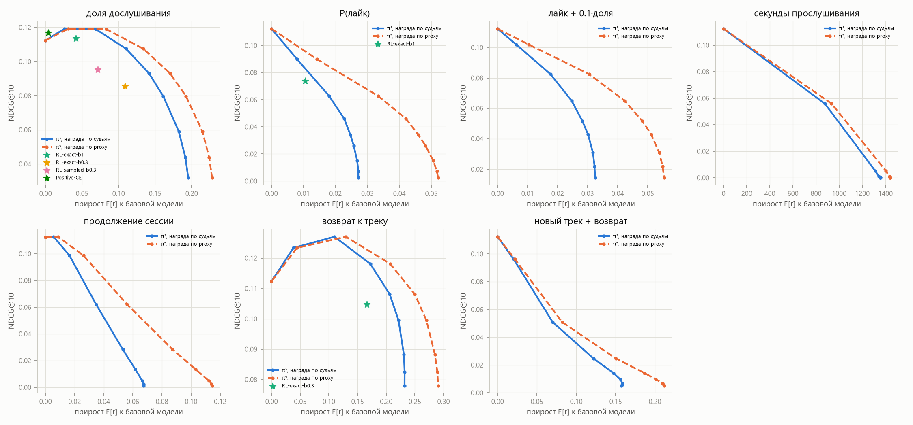
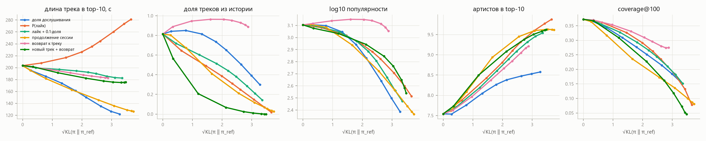
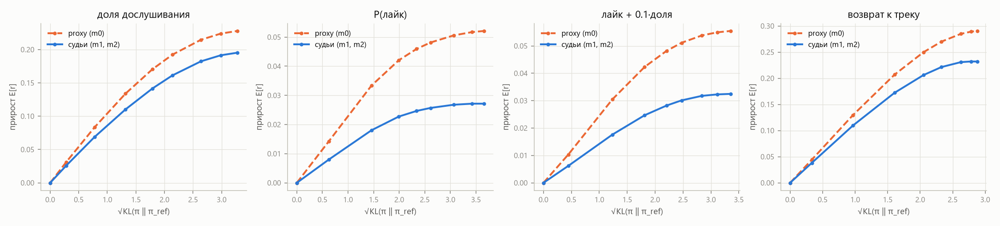
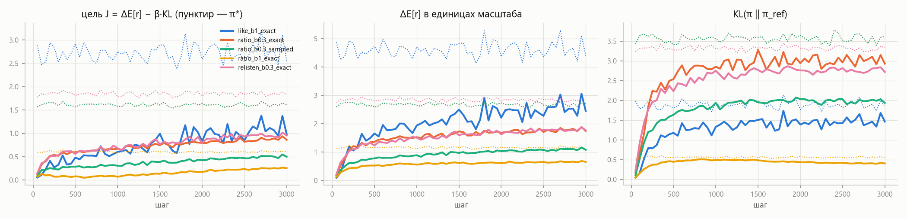

# Этап 3. RL-дообучение

## Постановка

Рекомендация следующего трека — одношаговый бандит:
- **состояние** s — история пользователя;
- **действие** a — трек из словаря (172 375 треков);
- **награда** r(s, a) — предсказание reward model m0 (proxy) для этого трека в режиме «рекомендация».

Цель такая же, как в RLHF для языковых моделей:

```
J(π) = E_s [ E_{a~π(·|s)} r(s,a) − β · KL(π(·|s) ‖ π_ref(·|s)) ],     π_ref — базовая GPT-2 из этапа 1
```

У этой задачи известен оптимум в явном виде: **π\*(a|s) ∝ π_ref(a|s) · exp(r(s,a) / β)**. Действий конечное число, и reward model оценивает их все одним проходом. Поэтому и цель, и её градиент считаются по всему словарю точно, без сэмплирования. Это отличие от языковых моделей, где пространство ответов комбинаторное. Здесь оно используется тремя способами ([`rl.py`](../src/seqrec_rl/rl.py)):

1. **π\* — переранжирование без обучения.** Выдача — top-K по `log π_ref + r/β`. Дёшево прогоняется по сетке наград и β ([`scripts/rl_sweep.py`](../scripts/rl_sweep.py)). Это граница того, чего может достичь любая политика при данной награде и β.
2. **RL с точным градиентом** ([`scripts/rl_train.py`](../scripts/rl_train.py), `--method exact`). Дообучается сама GPT-2:
   - лосс: `−Σ_a π(a)·r(a) + β·KL`, считается по всему словарю;
   - состояния — случайные моменты в историях пользователей из `train`;
   - 3 000 шагов по 32 состояния, AdamW lr 3e-4 с косинусным затуханием, dropout выключен;
   - ~8 минут на прогон.
3. **RL с сэмплированием** (`--method sampled`) — так обычно дообучают языковые модели. На каждое состояние сэмплируется 16 треков. Используется REINFORCE с baseline «среднее по остальным в группе», как в RLOO/GRPO, плюс тот же KL. Оценка градиента несмещённая для той же цели, отличается только дисперсией.

   Нормировку преимущества на std группы, как в GRPO, я намеренно не делал. Она меняет саму цель, и прогоны перестали бы быть сопоставимыми по β.

Для сравнения сделан бейзлайн без RL и без reward model — **Positive-CE (filtered behaviour cloning)**. Это продолжение next-item обучения базовой модели только на треках, дослушанных хотя бы наполовину: 1 500 шагов ([`scripts/finetune_positive.py`](../scripts/finetune_positive.py)).

**Масштаб наград.** Награды измеряются в разных единицах, поэтому каждая делится на свой типичный разброс при π_ref: `mean_s sqrt(Var_{π_ref}[r|s])` на 512 состояниях из `train` ([`scripts/rl_scales.py`](../scripts/rl_scales.py)). Значение β одинаково по смыслу для всех наград: β = 1 — штраф в «один типичный разброс награды».

| награда | формула | масштаб |
|---|---|---|
| `ratio` | E[доля дослушивания] | 0.065 |
| `like` | P(лайк) | 0.0066 |
| `like_plus_ratio` | P(лайк) + 0.1·E[доля], как в статье 2607.02818 | 0.0095 |
| `seconds` | E[доля] × длина трека | 34.5 с |
| `cont` | E[продолжение сессии] | 0.021 |
| `relisten` | P(дослушает этот трек снова в течение 7 дней) | 0.068 |
| `discovery` | P(relisten) · [трек новый для пользователя] | 0.032 |

**Оценка** — на тестовых состояниях этапа 1 (4 600 пользователей, срез на начало последних суток):
- релевантность — NDCG, Recall и MAP по протоколам `all` и `new`;
- свойства top-10;
- KL(π ‖ π_ref);
- ожидаемая награда E_π[r] по proxy m0 и по судьям m1 + m2, которые RL не видел.

## Результаты: π\* по сетке наград и β



По оси x — прирост ожидаемой награды к базовой модели, по оси y — NDCG@10. Сплошная линия — награда по судьям, пунктир — по proxy. Звёздочки — обученные политики (о них ниже).

Выборка из таблицы ([`results/stage3_tables.md`](results/stage3_tables.md); все 113 политик — в [`results/rl_sweep.json`](results/rl_sweep.json)):

| политика | β | KL | NDCG@10 | MAP@10 | Recall@100 | new NDCG@10 | ΔE proxy | ΔE судьи | длина, с | из истории | log10 попул. | Jaccard | топ-1 у одного трека |
|---|---|---|---|---|---|---|---|---|---|---|---|---|---|
| GPT-2 (π_ref) | — | 0 | 0.112 | 0.065 | 0.195 | 0.039 | 0 | 0 | 203 | 0.81 | 3.10 | 0.001 | 0.6 % |
| π\* ratio | 1 | 0.60 | **0.119** | **0.069** | **0.207** | 0.037 | +0.083 | +0.069 | 185 | 0.85 | 3.10 | 0.002 | 1.1 % |
| π\* ratio | 0.3 | 3.20 | 0.093 | 0.051 | 0.165 | 0.024 | +0.170 | +0.142 | 161 | 0.74 | 2.94 | 0.006 | 2.2 % |
| π\* ratio | 0.02 | 10.7 | 0.032 | 0.015 | 0.063 | 0.006 | +0.228 | +0.195 | 122 | 0.30 | 2.39 | 0.065 | 25.7 % |
| π\* like | 1 | 2.13 | 0.063 | 0.035 | 0.125 | 0.032 | +0.033 | +0.018 | 217 | 0.49 | 3.02 | 0.006 | 4.8 % |
| π\* like | 0.02 | 13.4 | 0.003 | 0.001 | 0.008 | 0.002 | +0.052 | +0.027 | 281 | 0.02 | 2.52 | 0.067 | 14.7 % |
| π\* like_plus_ratio | 1 | 1.53 | 0.082 | 0.047 | 0.154 | 0.035 | +0.031 | +0.018 | 197 | 0.60 | 3.05 | 0.003 | 3.7 % |
| π\* seconds | 3 | 6.08 | 0.056 | 0.032 | 0.128 | 0.008 | +934 с | +876 с | 1518 | 0.30 | 2.30 | 0.156 | 21.8 % |
| π\* seconds | 0.02 | 14.7 | 0.000 | 0.000 | 0.001 | 0.000 | +1441 с | +1357 с | 2228 | 0.01 | 1.69 | 0.383 | 52.7 % |
| π\* cont | 1 | 0.62 | 0.099 | 0.056 | 0.177 | 0.028 | +0.026 | +0.016 | 182 | 0.67 | 3.08 | 0.002 | 0.8 % |
| π\* relisten | 1 | 0.94 | **0.127** | **0.074** | **0.229** | 0.039 | +0.130 | +0.110 | 196 | 0.95 | 3.14 | 0.004 | 2.6 % |
| π\* relisten | 0.3 | 4.20 | 0.108 | 0.060 | 0.219 | 0.030 | +0.250 | +0.206 | 188 | 0.96 | 3.15 | 0.009 | 5.0 % |
| π\* discovery | 1 | 1.42 | 0.051 | 0.026 | 0.115 | 0.034 | +0.082 | +0.070 | 191 | 0.21 | 3.03 | 0.009 | 4.6 % |
| π\* discovery | 0.1 | 11.0 | 0.007 | 0.003 | 0.012 | 0.013 | +0.210 | +0.159 | 175 | 0.00 | 2.65 | 0.088 | 23.4 % |

«Jaccard» — среднее пересечение top-10 у случайных пар пользователей. «Топ-1 у одного трека» — доля пользователей, у которых первым стоит самый частый первый трек.

### Как меняется поведение



1. **Награда выигрывается тем, что предсказал EDA.**
   - `ratio` и `cont` сокращают треки: с 203 до 122 с.
   - `like` удлиняет их: до 281 с.
   - `seconds` сводит выдачу к нескольким часовым записям.
   - `relisten` поднимает долю повторов до 95 %.
   - `discovery` убирает повторы совсем.

   Это не ошибка оптимизатора. Reward model выучила реальные закономерности данных: короткое чаще дослушивают, длинное чаще лайкают, знакомое чаще переслушивают. Оптимизация просто доводит их до предела.
2. **Выдача уходит в длинный хвост и становится одинаковой для всех.** С ростом KL падает популярность рекомендуемых треков, снижается покрытие каталога, растёт сходство списков между пользователями.
   - При сильной оптимизации доли дослушивания у четверти пользователей первым стоит один и тот же трек.
   - При награде за секунды — у половины.

   Причина в устройстве награды. В reward model есть слагаемые, не зависящие от пользователя: сдвиг трека `b(a)` и поправка на длину `len(a)`. Когда β мал, они перевешивают персональную часть, и все получают одни и те же «объективно выгодные» треки. Внутри одного списка артистов при этом больше (7.5 → 9–10): выбираются разные «выгодные» треки, а не несколько песен любимого исполнителя.
3. **Переоптимизация измерима.**

   

   Для `ratio` и `relisten` судьи подтверждают 80–85 % прироста, который видит proxy. Для `like` и `like_plus_ratio` — только около половины, и по судьям прирост выходит на плато, пока proxy продолжает расти. Это та же картина, что у Gao et al. для RLHF: награду с высокой неопределённостью модели (редкий лайк, длинный хвост) оптимизатор взламывает. Награду, отражающую устойчивую закономерность данных, он честно наращивает.

### Сохраняется ли релевантность

- **При слабой оптимизации доли дослушивания и возврата к треку релевантность растёт.**
  - π\* ratio при β = 1: NDCG@10 +6 %, MAP@10 +6 %, Recall@100 +6 % при KL 0.6.
  - π\* relisten при β = 1: NDCG@10 +13 %, MAP@10 +13 %, Recall@100 +17 %, лайки Recall@100 +9 %.

  Объяснение: reward model видит отклик на прошлые треки (что пропускал, что дослушивал), а политика — только идентификаторы треков. Слабое смешивание π_ref с наградой добавляет эту информацию. Кроме того, таргеты теста — сами дослушанные треки, и 70 % из них — повторы. Награды, связанные с дослушиванием и повторами, сонаправлены с метрикой.
- **Протокол `new` этого выигрыша не показывает.** NDCG@10 по новым трекам падает при любой награде (0.039 → 0.037 у ratio при β = 1), кроме relisten при β = 1, где он не меняется. Даже `discovery`, награда за новые треки, к которым пользователь вернётся, ухудшает угадывание новых треков на следующий день. Reward model с одинаковым успехом «верит» в новые треки из длинного хвоста, а реальные новые таргеты — в основном популярные.
- **При β ≤ 0.3 релевантность падает для всех наград.** Награды `like`, `like_plus_ratio`, `cont` и `seconds` ухудшают её с самого начала.
- **Защиты** ([рисунок](figures/rl_defences.png)):
  - пессимизм `r − κ·|r_m0 − r_scratch|/2` при κ = 1 немного сдвигает фронт `like` и `like_plus_ratio` вправо, давая больше прироста по судьям при том же NDCG;
  - при κ = 3 пессимизм слишком консервативен и проигрывает. Разброс двух моделей оказался плохим индикатором ошибок именно proxy;
  - ограничение кандидатов top-200 базовой модели срезает достижимый прирост и для `like` проигрывает обычному KL.

## RL-обучение против π\*



| политика | KL | NDCG@10 | Recall@100 | new NDCG@10 | ΔE proxy | ΔE судьи | длина, с | из истории | log10 попул. | coverage@10 | топ-1 у одного трека | J / J\* на train |
|---|---|---|---|---|---|---|---|---|---|---|---|---|
| π\* ratio β = 1 | 0.60 | 0.119 | 0.207 | 0.037 | +0.083 | +0.069 | 185 | 0.85 | 3.10 | 0.101 | 1.1 % | 1 |
| RL exact, ratio β = 1 | 0.43 | 0.113 | 0.194 | 0.038 | +0.047 | +0.042 | 183 | 0.81 | 3.14 | 0.093 | 1.3 % | 0.42 |
| π\* ratio β = 0.3 | 3.20 | 0.093 | 0.165 | 0.024 | +0.170 | +0.142 | 161 | 0.74 | 2.94 | 0.081 | 2.2 % | 1 |
| RL exact, ratio β = 0.3 | 3.13 | 0.086 | 0.151 | 0.027 | +0.119 | +0.109 | 144 | 0.65 | 2.98 | 0.054 | 4.6 % | 0.53 |
| RL sampled, ratio β = 0.3 | 2.05 | 0.095 | 0.171 | 0.031 | +0.076 | +0.071 | 171 | 0.79 | **3.29** | 0.068 | 1.6 % | 0.31 |
| π\* like β = 1 | 2.13 | 0.063 | 0.125 | 0.032 | +0.033 | +0.018 | 217 | 0.49 | 3.02 | 0.088 | 4.8 % | 1 |
| RL exact, like β = 1 | 1.57 | 0.074 | 0.149 | 0.029 | +0.017 | +0.011 | 221 | 0.63 | 3.00 | 0.085 | 6.4 % | 0.39 |
| π\* relisten β = 0.3 | 4.20 | 0.108 | 0.219 | 0.030 | +0.250 | +0.206 | 188 | 0.96 | 3.15 | 0.069 | 5.0 % | 1 |
| RL exact, relisten β = 0.3 | 3.73 | 0.105 | 0.168 | 0.029 | +0.175 | +0.166 | 185 | 0.77 | **3.34** | 0.045 | 5.4 % | ~0.5 |
| **Positive-CE** (без RM) | **0.06** | **0.117** | 0.197 | **0.041** | +0.004 | +0.004 | 200 | 0.82 | 3.13 | 0.108 | 0.6 % | — |

1. **RL-политики всюду внутри фронта π\*.** При сопоставимом KL они получают меньше награды и такую же или меньшую релевантность. Цель J на обучающих состояниях доходит до 40–55 % от J\* и выходит на плато. Это не недообучение: увеличение lr только дестабилизирует обучение.

   Причина — асимметрия информации. π\* использует награду, которая видит отклик пользователя на каждый трек истории. Политика видит только последовательность идентификаторов. Поэтому она может выучить лишь награду, усреднённую по состояниям с одинаковой историей треков, — «амортизированную» часть π\*. Остальное недостижимо без изменения входа политики.
2. **Обученная политика однообразнее π\*.** Усреднённая награда сильнее зависит от трека, чем от пользователя. При том же KL у RL-политики ниже покрытие каталога (0.054 против 0.081) и чаще совпадает первый трек (4.6 % против 2.2 %).
3. **Точный градиент против сэмплирования.** За те же 3 000 шагов сэмплированный вариант с 16 треками на состояние набирает J = 0.50 против 0.86 у точного. Дисперсия оценки на словаре из 172 тысяч действий велика.

   У сэмплирования есть и качественный эффект: оно **поднимает популярность** выдачи (log10 3.10 → 3.29), а точный градиент её снижает. Градиент приходит только в сэмплированные, то есть уже вероятные, треки, и обучение укрепляет популярное. То же у `relisten`. Такое смещение к популярному — свойство оценщика, а не цели.
4. **Positive-CE — лучший результат по релевантности при минимальном сдвиге.** NDCG@10 +4 %, new NDCG@10 +5 %, лайки Recall@100 +6 % при KL 0.06. Reward model не нужна, хаков нет. Награду по reward model он почти не меняет.

   То есть если цель — точнее угадывать дослушивания, достаточно не обучаться на скипах. RL с reward model нужен там, где цель отличается от того, что записано в логах. Именно там он и опасен.

## Ответы на исследовательские вопросы

**1. Как меняется поведение модели? Удаётся ли максимизировать вознаграждение?**

Да, и по proxy, и по независимым судьям награда растёт монотонно с KL. Например, ожидаемая доля дослушивания вырастает с 0.64 до 0.84 по судьям. Рост достигается сдвигом в сторону свойств треков, которые reward model связывает с наградой:
- длина: короче для доли дослушивания и продолжения сессии, длиннее для лайков и секунд;
- повторы для возврата к треку;
- длинный хвост и одинаковая для всех выдача при сильной оптимизации.

Для наград с высокой неопределённостью (лайк) примерно половина прироста — переоптимизация proxy.

**2. Сохраняется ли релевантность?**

При KL < 1 и наградах `ratio` и `relisten` — да, она даже растёт на 6–13 % по NDCG и MAP. Дальше быстро падает. Награды `like`, `cont`, `seconds` и `discovery` ухудшают релевантность сразу. Однообразие проверено тремя способами — покрытием каталога, Jaccard между пользователями и долей одинакового первого трека. При β ≤ 0.1 модель действительно начинает рекомендовать многим одно и то же: до 25–50 % пользователей получают один и тот же первый трек.

**3. Можно ли приблизиться к долгосрочным целям?**

Сигналы в данных:
- **`cont`** — сколько ещё треков пользователь дослушает в этой сессии.
- **`relisten`** — вернётся ли к треку за неделю.
- **`discovery`** — новый трек, к которому вернётся.
- **Время до следующей сессии.** Слабый сигнал: 85 % пользователей возвращаются в течение суток, потому что в датасет отобраны активные.
- **Органические действия после рекомендации** — например, пользователь потом сам ищет артиста.

Что показал офлайн:
- `cont` механически перепутан с долей дослушивания (EDA) и при оптимизации даёт те же короткие треки;
- `relisten` reward model предсказывает хуже бустинга (AUC 0.80 против 0.82), и оптимизация превращает его в «повторяй знакомое»;
- `discovery` убирает повторы, но ухудшает угадывание новых треков.

Офлайн можно проверить:
- насколько хорошо модель предсказывает долгосрочный сигнал на отложенных пользователях;
- согласуются ли независимые reward model;
- как политика сдвигает распределение выдачи;
- совпадает ли выдача с реальным поведением на следующий день.

Нельзя проверить причинный эффект рекомендации на возвраты. Логи собраны под другой политикой, рекомендуемых треков в таком контексте никто не показывал, вероятности показа старой системы неизвестны (корректный IPS невозможен), а петли обратной связи и привыкание проявляются за недели. Для этого нужен A/B-тест с метриками удержания: доля вернувшихся, длина сессий, лайки через месяц. До него — хотя бы off-policy оценка с восстановленной политикой логирования, как в статье 2607.02818.

**4. Генерация на несколько шагов** — это этап 4.

**5. Компромисс между релевантностью и вознаграждением.**

Увеличить награду без потери точности можно, но только немного (KL ≲ 1) и только для наград, сонаправленных с тем, что пользователь реально делает (`ratio`, `relisten`). Компромисс определяется в первую очередь функцией вознаграждения, во вторую — силой KL. Метод оптимизации на третьем месте: RL-обучение не превосходит переранжирование π\* и проигрывает ему из-за асимметрии информации. Пессимизм по ансамблю помогает слабо. Простейший бейзлайн без RL (Positive-CE) даёт лучший прирост релевантности.

## Ограничения

- **Proxy и судьи** — одна архитектура, одни логи. Их согласие не равно истине, особенно в длинном хвосте.
- **Один сид на каждый RL-прогон**, 3 000 шагов. Доверительные интервалы по пользователям не считались: при 4 600 пользователях и разнице NDCG в 0.005–0.01 они нужны для строгих выводов о малых эффектах.
- **Политика и reward model видят разное.** Это объясняет разрыв RL и π\*, но из-за этого сравнение «RL против переранжирования» отчасти сравнивает и входные данные. Политика с признаками отклика — естественное продолжение.
- **Одношаговая постановка.** Награда не учитывает, что следующая рекомендация зависит от этой, — это этап 4.
