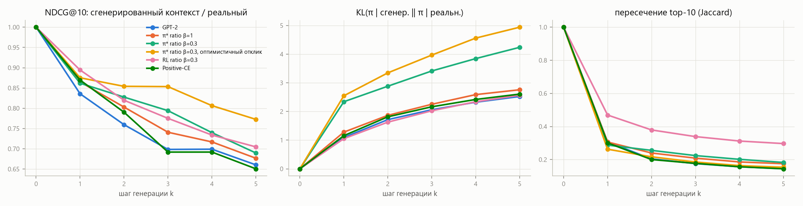
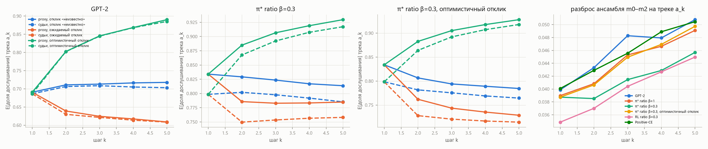

# Этап 4. Генерация на несколько шагов

## Постановка

[`scripts/rollouts.py`](../scripts/rollouts.py), [`rollout.py`](../src/seqrec_rl/rollout.py).

- **Пользователи** — 2 000 случайных тестовых пользователей, у которых в тестовый день больше 5 прослушиваний.
- **Генерация.** От состояния на начало тестового дня политика порождает треки a₁ … a₅. Каждый добавляется в контекст политики, в контекст reward model и в историю пользователя, как если бы пользователь его послушал.
- **Эталон.** Та же политика идёт по **реальному** продолжению: в контекст по очереди добавляются первые 5 прослушиваний пользователя в тестовый день с реальным откликом.

На шаге k сравниваются оба варианта:
- **релевантность** top-10 к оставшимся реальным трекам дня (Listen+ после первых k реальных событий);
- **KL** между распределениями следующего трека при сгенерированном и реальном контексте и пересечение top-10;
- **свойства трека a_k:** дослушан ли он реально в этот день, есть ли в истории, тот же ли артист, что у a_{k−1}, длина;
- **зацикливание:** доля шагов, где argmax политики — уже сгенерированный трек. При жадном декодировании такие треки запрещены, но попытку считаем;
- **награда a_k** по proxy m0 и по судьям m1 + m2, а также разброс ансамбля.

**Отклик на сгенерированный трек** reward model должна откуда-то взять. Проверены три допущения:

| допущение | корзина доли дослушивания | пауза |
|---|---|---|
| «неизвестно» | токен «неизвестно», на нём RM училась (5 % позиций) | «неизвестно» |
| ожидаемый | корзина доли, которую предсказала сама m0 | ~3 мин |
| оптимистичный | полное прослушивание | ~3 мин |

**Политики:**
- базовая GPT-2;
- π\* для доли дослушивания при β = 1 и β = 0.3 — на каждом шаге reward model заново оценивает словарь по сгенерированному контексту с откликом «неизвестно»;
- π\* β = 0.3, но решения принимаются по контексту с **оптимистичным** откликом;
- RL-политика (доля дослушивания, β = 0.3, точный градиент);
- Positive-CE.

Декодирование — жадное без повторов внутри развёртки. Для GPT-2 и π\* β = 0.3 дополнительно — сэмплирование.

## Дрейф контекста и последующие рекомендации

| GPT-2, жадно | k = 0 | 1 | 2 | 3 | 4 | 5 |
|---|---|---|---|---|---|---|
| NDCG@10, сгенерированный контекст | 0.109 | 0.101 | 0.096 | 0.092 | 0.089 | 0.085 |
| NDCG@10, реальный контекст | 0.109 | 0.121 | 0.127 | 0.132 | 0.127 | 0.129 |

1. **По реальному продолжению рекомендации улучшаются, по сгенерированному — ухудшаются.**
   - Если модель видит, что пользователь действительно включил, NDCG@10 растёт на 18 % за 5 шагов.
   - Если в контекст попадает собственная генерация, NDCG@10 падает на 22 %.
   - К 5-му шагу разница — треть.

   Уже после одного шага top-10 по сгенерированному и реальному контексту пересекаются лишь на 30 %. KL между распределениями растёт почти линейно и к 5-му шагу достигает 2.5 нат у GPT-2 и 4–5 нат у π\*.
2. **Модель принимает свою рекомендацию за факт и подкрепляет её.**
   - В 71–78 % шагов самый вероятный следующий трек для GPT-2 — тот, который она только что сгенерировала. У RL-политики — в 95–99 %.
   - Это следствие данных. В реальных историях трек в контексте — свидетельство, что пользователь его выбрал, а 71 % прослушиваний — повторы. Подставленный трек выглядит как свежее любимое.
   - Даже при запрете повторов растёт доля того же артиста подряд: 25 % → 29 % у GPT-2, 25 % → 34 % у RL. Генерация уходит в цепочки одного исполнителя.
   - Доля треков из реальной истории падает: 92 % → 81 %.
   - Доля треков, которые пользователь реально дослушал в этот день, падает с 15 % на первом шаге до 9.5 % на пятом.

   Это аналог exposure bias из генерации текста. Модель обучалась только на реальных префиксах и не видела своих.
3. **Сэмплирование ухудшает развёртку сильнее жадного выбора.** Попадание a_k в реальные треки — 6 % против 15 %. Слейт с сэмплированием вдвое хуже (NDCG@5 0.059 против 0.126). Случайный трек из хвоста распределения уводит контекст ещё дальше.

## Оценка вознаграждения на сгенерированных траекториях

Ожидаемая доля дослушивания трека a₅ на **одной и той же** траектории GPT-2:

| допущение об откликах a₁…a₄ | proxy m0 | судьи m1 + m2 | разброс ансамбля на a₅ (на a₁ — 0.040) |
|---|---|---|---|
| «неизвестно» | 0.718 | 0.703 | 0.051 |
| ожидаемый | 0.609 | 0.608 | 0.039 |
| оптимистичный | **0.890** | **0.885** | **0.021** |

Для сравнения, на реальных первых пяти треках дня reward model точна: она предсказывает 0.674 при фактической доле 0.692.

1. **Оценка награды на шагах 2–5 определяется не выбором трека, а допущением об отклике.** Разница между допущениями (0.61 против 0.89) вдвое больше, чем вся разница между GPT-2 и π\* β = 0.3 на первом шаге (0.69 против 0.83).

   Reward model выучила инерцию сессии: после серии полных прослушиваний следующий трек тоже дослушивают. Оптимистичное допущение создаёт выдуманную идеальную сессию и делает любую траекторию выгодной. Сумма наград за 5 шагов при таком допущении — самоисполняющийся прогноз.
2. **«Ожидаемый» отклик тоже плох.** Доля дослушивания двугорба: либо скип, либо полное прослушивание. Её среднее (~0.7) попадает в корзину «50–80 %», которая в реальности встречается редко и предшествует обрыву сессии. Подстановка среднего создаёт нетипичное состояние, и оценки по шагам падают. Корректнее сэмплировать отклик из распределения, которое предсказывает reward model, а не подставлять среднее.
3. **Ансамбль эту ошибку не ловит.** Судьи повторяют proxy с точностью до 0.01–0.02 при любом допущении: все модели выучили одну и ту же закономерность. Разброс ансамбля при «неизвестном» отклике растёт с шагом (0.040 → 0.051), то есть контекст уходит из распределения обучения. А при оптимистичном разброс **уменьшается** вдвое: модели всё увереннее в выдуманной серии полных прослушиваний. Пессимизм по неопределённости ансамбля, который на этапе 3 немного помогал для лайков, здесь ничего не исправит.
4. **Политика, которая верит своим рекомендациям, ведёт себя иначе.** π\* β = 0.3 с оптимистичным контекстом держится ближе к истории: доля треков из истории 0.80 → 0.78, против 0.80 → 0.70 при «неизвестном» отклике. Она дольше сохраняет релевантность (на 5-м шаге 78 % от реального контекста против 69 %). Зато по честной оценке с «неизвестным» откликом её треки хуже: 0.785 против 0.814. Она оптимизирует награду в собственной фантазии.

## Next-K против Top-K

Как в GPTRec (статья 2403.04875): слейт из 5 треков можно взять как top-5 одного распределения (Top-K) или собрать по шагам, каждый раз добавляя выбранный трек в контекст (Next-K, жадно без повторов).

| политика | Top-K NDCG@5 | Next-K NDCG@5 | Top-K HitRate@5 | Next-K HitRate@5 | артистов Top-K | артистов Next-K |
|---|---|---|---|---|---|---|
| GPT-2 | 0.121 | 0.126 | 0.327 | 0.308 | 4.04 | 3.75 |
| π\* ratio β = 1 | 0.126 | 0.132 | 0.328 | 0.323 | 4.15 | 3.78 |
| π\* ratio β = 0.3 | 0.100 | 0.101 | 0.283 | 0.270 | 4.36 | 3.94 |
| RL ratio β = 0.3 | 0.091 | 0.091 | 0.264 | 0.251 | 4.14 | 3.56 |
| Positive-CE | 0.125 | **0.134** | 0.331 | 0.313 | 4.03 | 3.80 |
| GPT-2, сэмплирование | 0.121 | 0.059 | 0.327 | 0.153 | 4.04 | 4.55 |

Next-K не хуже или чуть лучше по NDCG@5 (от 0 до +7 %), но хуже по HitRate@5 и менее разнообразен по артистам. Он учитывает зависимости между треками: следующий трек «подходит» к предыдущему, часто тот же артист или альбом. У тех пользователей, кому слейт подошёл, попаданий больше, но слейт угадывает меньшее число пользователей. В GPTRec Next-K нужен, чтобы оптимизировать свойства всего списка (разнообразие), и для этого его специально дообучали. Без такого дообучения пошаговая сборка слейта даёт обратный эффект: разнообразие по артистам снижается.

## Выводы по вопросу 4

- **Последующие рекомендации деградируют.** Сгенерированная рекомендация не равна прослушиванию, а модель, обученная на реальных историях, воспринимает её как прослушивание. Она начинает повторять и развивать собственный выбор: тот же трек, тот же артист. За 5 шагов релевантность падает на 22 % относительно стартовой и на треть относительно контекста с реальным продолжением.
- **Оценка вознаграждения становится артефактом.** На шаге k > 1 reward model оценивает не трек, а выдуманную историю. Её вердикт задаётся тем, какой отклик мы приписали прошлым сгенерированным трекам. Ни судьи, ни разброс ансамбля этого не показывают.
- **Многошаговый RL я не обучал, хотя он был в исходном плане.** Сумма наград по 5 сгенерированным шагам была бы целью, которую можно поднять выбором допущения об отклике. При оптимистичном допущении — «рекомендуй то, после чего модель считает сессию идеальной». При «неизвестном» — эксплуатировать состояния, которые reward model почти не видела в обучении (5 % позиций). Корректная многошаговая цель требует симулятора отклика:
  - отклик сэмплируется из распределения, а не берётся средним или оптимистичным;
  - симулятор проверен на реальных многошаговых траекториях;
  - есть off-policy коррекция, как в статье 2607.02818, где все многошаговые выводы тоже сделаны «внутри» той же модели отклика.

  Окончательный ответ на вопрос, помогает ли многошаговая оптимизация удержанию, может дать только онлайн-эксперимент.

## Ограничения

- 2 000 пользователей, один прогон генерации. Сэмплирование — только для двух политик.
- «Реальное продолжение» — первые 5 прослушиваний дня, а не реакция пользователя на наши рекомендации. Как пользователь отреагировал бы на сгенерированный трек, по логам узнать нельзя.
- Proxy и судьи — одна архитектура, обученная на одних данных. Их согласие говорит о том, что выученная закономерность общая, а не о том, что она верна для сгенерированных состояний.
